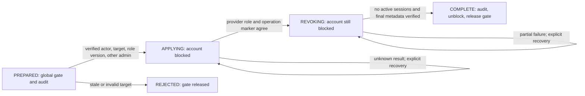

# Batch 18: Authentication, role recovery, and student entry flows

Follow-up: [batch 19](19-tooling-ci.md) implements tooling/CI cleanup, including
strict clean installs and a full synthetic browser CI job. Its verification also
reruns this batch's tests without application environment files.

Implemented locally on 2026-11-12 after the batch-17 checkpoint `6b03841`.
This completes the local authentication/role/session remediation deferred in
[batch 17](17-document-settings-validation.md), plus the remaining student entry
and auth-page issues. No application database, real account, live session, payment,
email, environment variable, or deployment was changed. These changes are uncommitted.

## 1. Codebase architecture and design

| Priority | Location | Finding and implemented recommendation |
| --- | --- | --- |
| High | `src/lib/auth.ts`; queue, finance, directory loaders; layouts, home, receipt, and student API | Guards and route decisions trusted JWT role claims independently. One server boundary now verifies the current Clerk session, ownership, expiry, current account status/role, and any managed-account fence. Unknown roles, blocked accounts, revoked sessions, mismatched metadata, and unavailable verification fail closed. Every action still guards itself. Proxy authenticates routes; authoritative role decisions happen beside protected reads/writes. |
| High | `src/lib/role-operations.ts`, `role-policy.ts`, `admin.actions.ts`; new migration | The role action performed a provider read/count/write and a partial session sweep without durable state. Role changes now have an actor-scoped intent, observed role/version, unique global operation gate, fenced worker lease, persistent recovery stage, and atomic database audits. Clerk remains the identity/role provider; the database fence also has to agree and never grants access by itself. |
| Medium | `src/components/session-guard.tsx`, `src/app/api/session/route.ts`, root layout | A side-effect-only guard signed users out on any reload exception. A verified, private/no-store session snapshot now controls protected content. A transport/provider outage hides content and permits recovery without automatically signing out. Account/path changes discard obsolete checks; focus and 30-second checks detect idle changes. |
| Medium | `src/app/error.tsx` | Access/provider failures could leave only an opaque page error. A sanitized recovery screen offers retry and explicit sign-out. It uses the installed Next.js 16.4 `retry` API, which re-fetches the affected content. |

`getVerifiedActor` uses React cache only to deduplicate one server render. It does
not reuse authorization across requests; actions and route handlers verify afresh.
Administrators and employees are rejected by student-only request/history entry
points even when their JWT/client role metadata is stale.

### Durable role operation

- New role changes are serialized by the database unique active key, including
  opposing administrator demotions. The actor is reauthorized after acquiring the
  gate. Self changes are rejected; administrator demotion requires another
  verified administrator in the complete, bounded account snapshot.
- A managed account's role and `roleOperationId` must match `RoleAccess`, and its
  blocked flag must be false. The target is blocked transactionally before the
  provider write. Pending demotions therefore do not depend on JWT refresh or
  successful session revocation to remove access.
- Metadata writes contain the same role/operation marker for a given intent.
  Replaying an intent cannot change its actor, target, previous version, or role.
  A completed replay returns its recorded result without another mutation/audit.
- Recovery first reads the provider. An applied write with a lost response is
  confirmed without repeating it. If its marker is absent, only the explicit
  **Resume role recovery** action may repeat the identical approved payload. The
  UI displays the target and requested roles before that action.
- Active sessions are consumed from page zero of the shrinking list, 100 at a
  time, with at most ten revoke calls together. Offset pagination during deletion
  would skip sessions. Work is bounded to 5,000 revocations and a checked 20-second
  sweep budget per attempt; remaining work stays durable for another attempt.
- A 60-second lease is renewed and checked before provider mutation batches and
  database completion. Stale workers cannot complete a newer worker's operation.
  Audit failure rolls back access release and gate release. No provider request
  runs inside a database transaction.
- Recovery is administrator-driven and survives a browser/server restart. No new
  cron or background schedule is required; the existing daily fallback is preserved.

## 2. Code quality and refactoring

| Priority | Location | Finding and implemented recommendation |
| --- | --- | --- |
| High | Student `dashboard/page.tsx` | Rendering the dashboard wrote `role: student` when the JWT lacked a role. This could overwrite a staff role before its claims refreshed. The write is removed; missing provider roles are interpreted as student without mutation. The student guard now runs before profile/settings access. |
| Medium | Student `new/request-form.tsx`, new-request page, `request.actions.ts` | A shared browser submission key survived account switches; editable fields could change after an unknown outcome. Intent storage is now account-scoped and UUID-validated, stores no personal fields, and freezes the exact in-memory payload for retry. A synchronous pending guard prevents duplicate activation; account/role changes unmount drafts and ignore late results. Explicit input rejection permits correction. |
| Medium | Sign-in/sign-up pages | Manual, OAuth, and verification attempts could overlap before loading state rendered. One synchronous ref guards each page's authentication operations. Typed `unknown` checks replace `any`, raw auth/provider error logging is removed, and changing the verification email is blocked while an operation is pending. |
| Low | Dashboard controls and imports | Unused imports and the remaining auth-page type escapes left lint failing. All are removed/fixed. Document/purpose/payment choices now use native buttons with pressed state, keyboard activation, and disabled behavior during submission/recovery. |

Server pricing, owner-scoped requests, frozen checkout quotes, payment/refund
rules, existing receipts, and notification delivery semantics remain intact.
Duplicate required form fields and file-valued text are rejected. Submitted money
and account fields still cannot override server pricing or authenticated ownership.

## 3. Security vulnerabilities and integrity

| Priority | Location | Finding and implemented recommendation |
| --- | --- | --- |
| High | Shared auth guards and all privileged loader entry points | A still-valid JWT could retain elevated access after demotion/revocation. Server operations now verify the live session/account and managed policy. Session/user ID mismatches, expired/inactive sessions, banned/locked users, unknown roles, and policy drift are denied before protected data access. A provider/database outage returns a sanitized unavailable result rather than falling back to claims. |
| High | Role workflow and migration | Concurrent cross-demotions, unaudited partial mutations, and incomplete revocation could leave misleading role state. Durable serialization, observed-version checks, current-actor verification, blocked target access, paginated revocation, transactionally recorded outcomes, and explicit recovery replace those paths. SQL constraints enforce role values and active/terminal operation states. |
| High | Receipt authorization; student history API/actions | Receipt elevation independently reread raw provider roles; student actions accepted any authenticated role. Receipt authorization now uses the verified actor's role, while request mutations and history APIs require the student role. Ownership and canonical money checks remain in force. |
| Medium | Session guard, student request form, role UI | Late responses and cached identity state could affect another account. Session checks are keyed by session/path and cancelled on cleanup; request results are ignored after unmount; role snapshots carry operation versions and block new changes during recovery. Invalid or redirected session snapshots never reveal the protected workspace. |

Clerk's session list is paginated and defaults to ten records; the implementation
uses explicit limits and consumes the shrinking active set.
[Clerk session-list reference](https://clerk.com/docs/reference/backend/sessions/get-session-list).
Current-session checks use the supported backend lookup.
[Clerk session reference](https://clerk.com/docs/reference/backend/sessions/get-session).
Metadata updates merge only the intended role and operation marker, preserving
unrelated metadata.
[Clerk metadata reference](https://clerk.com/docs/reference/backend/user/update-user-metadata).

## 4. Dead code and unused paths

| Priority | Location | Finding and implemented recommendation |
| --- | --- | --- |
| Medium | `admin.actions.ts`, `proxy.ts`, `session-guard.tsx` | Removed the one-shot role mutation/revocation implementation, duplicated claim-based proxy role branches, exception-driven automatic sign-out, and suppressed effect-dependency checks. Their responsibilities now have one shared boundary/workflow. |
| Low | Dashboard/auth pages and student controls | Removed the render-time role initializer, unused UI/navigation/icon imports, unsafe type escapes, and raw credential-flow error logging. No speculative asset or unrelated feature deletion was performed. |

## 5. Performance and reliability weaknesses

| Priority | Location | Finding and implemented recommendation |
| --- | --- | --- |
| High | Role recovery and `RoleAccess` | Provider timeouts previously lost the distinction between not applied, applied, and partially revoked. Persistent stages, marker verification, guarded replay, bounded work, and transactional completion keep uncertainty visible and access blocked. |
| Medium | Shared auth boundary and loaders | Fresh verification increases backend calls. Render-local deduplication reduces duplicate work without a cross-request privilege cache. Proxy does not query the application database. Policy queries use the user primary key or only IDs from a bounded account snapshot; historical policy rows are not loaded wholesale. |
| Medium | Session UI and student dashboard | Transient outages caused forced logout or a permissive new-request link. Unverified protected views are withheld, outages remain recoverable, and failed availability reads disable the new-request link while preserving verified history access. |

### Operational limits and rollout

1. Apply **`20261112000100_role_change_recovery` before deploying this release**.
   It adds `RoleAccess`, `RoleChangeOperation`, and one enum; it does not rewrite
   existing identities, money, or requests. No application migration was run here.
   Existing legacy identity/money reconciliation prerequisites still apply.
2. Deploy the auth boundary, API, role workflow, DTOs, and clients together. Reload
   open tabs. A missing migration or unavailable verification fails closed.
   Rebuild with intended configuration; `.next` from `build:check` is synthetic
   verification output, not a deployment artifact.
3. Pending role work appears in Settings. Refresh accounts, inspect the target and
   intended roles, then resume the recorded operation. Do not delete its row,
   unblock a target, replace its intent, or clear the global gate to bypass recovery.
   A crashed worker's lease may take up to 60 seconds to become claimable.
4. Clerk and Postgres do not share a transaction. An already-issued external call
   cannot be cancelled by a later account change or lease expiry. A delayed older
   metadata write cannot restore application privileges because its role/marker
   fails the policy check, but it can cause a fail-closed availability incident.
   Post-completion provider drift requires an authorized operator to compare the
   latest audit/operation, policy, and Clerk record and restore their agreement.
   Do not edit managed role metadata independently in normal operation. External
   console changes and provider deletion remain outside the application gate.
5. Live Clerk behavior, OAuth/OTP/MFA configuration, authenticated deployment
   behavior, native hosted Postgres contention, and production rate limits remain
   release verification. No real account/session or provider mutation was used.
   Client checks cannot retract data already delivered to a browser or cancel an
   already-authorized action; server checks remain the security boundary.

### Validation

- **722 Vitest tests across 38 files passed.** This includes 26 current-session
  guard cases, 12 real-database role workflow cases, five session API checks, three
  dashboard render cases, and the earlier financial/configuration regressions.
  Role coverage includes truly concurrent cross-demotions, partial/unknown provider
  writes, shrinking session pages, stale intent versions, active worker leases,
  audit rollback, delayed-marker denial, and SQL state constraints.
- **107 isolated Chrome checks passed**, including 14 new authentication/student
  entry cases and two new role recovery/version cases. Fixtures use synthetic
  provider actions/auth/data and block unrelated outbound requests. They exercise
  actual application components, not live Clerk or PayMongo.
- **All four migration scenarios passed with zero Prisma drift** across the
  ten-migration chain. Fresh/repeat deploy, legacy upgrade, actual generated-client
  CRUD for the new role tables, and existing migration safety checks use owned
  disposable databases. No native hosted database was contacted.
- **TypeScript, full ESLint (zero errors/warnings), production build, and cron HTTP
  checks passed.** Existing module-format tooling warnings are batch-19 work;
  dependency versions, environment files, and cron configuration are unchanged.
- Diff whitespace/conflict and changed-file secret-pattern checks passed. The
  dependency audit was not repeated for a change with no dependency modifications.
- The [phone request form](assets/18-student-request.png) was visually reviewed.
  The navigation controls at the top belong to the synthetic test fixture.

### Files changed

| Area | Files/modules |
| --- | --- |
| Persistence | `prisma/schema.prisma`, the new role-recovery migration |
| Authorization/workflow | `src/lib/auth.ts`, `role-policy.ts`, `role-operations.ts`, `admin.actions.ts`, `src/proxy.ts` |
| Protected reads | Queue, finance, directory and role loaders; role DTOs; home/layouts; receipt authorization; student history API |
| UI/entry | Role management, session guard/API, root error screen, student dashboard/new-request form/actions, sign-in/sign-up pages |
| Verification | Role/session/dashboard tests, updated authorization fixtures, new authentication browser fixture/checks, two role UI checks, migration smoke/replay helpers, `vitest.setup.ts` |
| Documentation | README, batch-17 follow-up, this report and phone screenshot |

The local batch-18 acceptance checks are satisfied. Production rollout verification
is outstanding. Continue with **batch 19: tooling/CI cleanup**, followed by the
final cleanup/performance review. No commit, push, merge, or deployment was performed.
